# MaxPID : modélisation d'un axe asservi (cinématique et moteur)

🇫🇷 [Français](#français) · 🇬🇧 [English](#english)

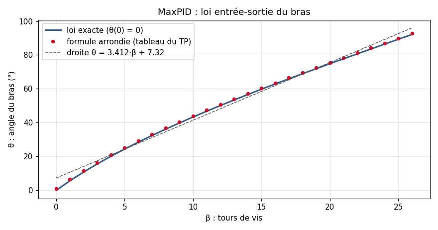

---

## Français

### Contexte
Travaux de sciences de l'ingénieur en **CPGE TSI** (janvier et mai 2024) sur le **MaxPID**, un banc didactique d'axe asservi : un moteur à courant continu entraîne une vis, dont l'écrou fait tourner un bras. J'en ai fait la modélisation en deux étapes :
1. **la cinématique** : schéma cinématique plan, fermeture géométrique, puis loi entrée-sortie entre la rotation de la vis et l'angle du bras ;
2. **le moteur** : modèle physique du moteur à courant continu sous **Simscape** (MATLAB).

En 2026, j'ai repris ces deux modèles et je les ai vérifiés avec des scripts Python (voir [Vérification en 2026](#vérification-en-2026)). Toutes les valeurs et équations sont réunies dans [`docs/valeurs.md`](docs/valeurs.md).

Le dépôt s'arrête à la modélisation : il ne contient pas de correcteur. Pour la boucle fermée, voir mon [régulateur PID](https://github.com/Valentin-Auger-Laboratoire/regulateur-pid).

---

### 1. Cinématique du bras (janvier 2024)

#### Schéma cinématique plan

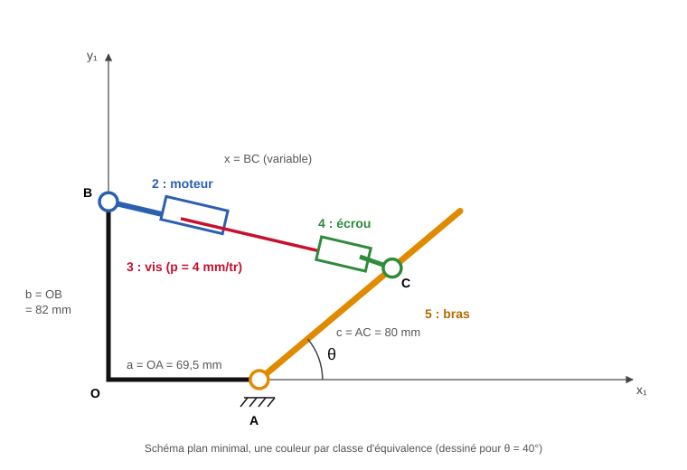

Le mécanisme spatial se ramène à un schéma plan, avec une couleur par classe d'équivalence :
- le bâti ;
- le corps du moteur (2), en pivot en B ;
- la vis (3) ;
- l'écrou (4), en liaison avec le bras en C ;
- le bras (5), en pivot en A.

Cotes : OA = 69,5 mm, OB = 82 mm, AC = 80 mm, pas de la vis 4 mm/tour. La longueur x = BC varie quand la vis tourne.

#### Fermeture géométrique
J'écris la relation **OA + AC + CB + BO = 0**, je la projette sur x₁ et y₁, puis j'élimine l'angle α de la vis (cos² α + sin² α = 1) :

> **x(θ) = √(a² + b² + c² + 2c(a·cos θ − b·sin θ))**

| Relation de fermeture et projection | Élimination de α |
|---|---|
| 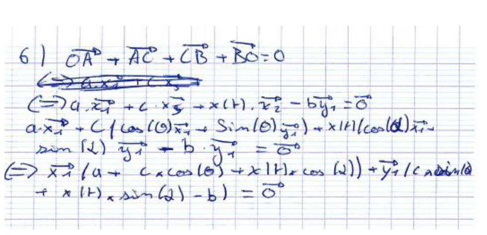 | 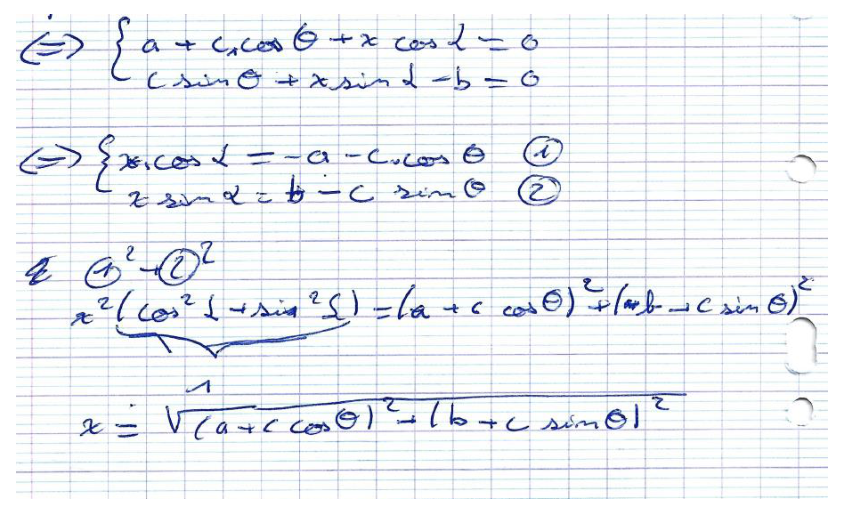 |

#### Système vis-écrou et loi entrée-sortie
Un tour de vis fait varier x d'un pas p, au signe de l'hélice près. En prenant β = 0 quand θ = 0 :

> **β(θ) = (x(0) − x(θ)) / p**, avec x(0) = √((a + c)² + b²) = 170,51 mm

| Vis-écrou | Loi β(θ) |
|---|---|
| 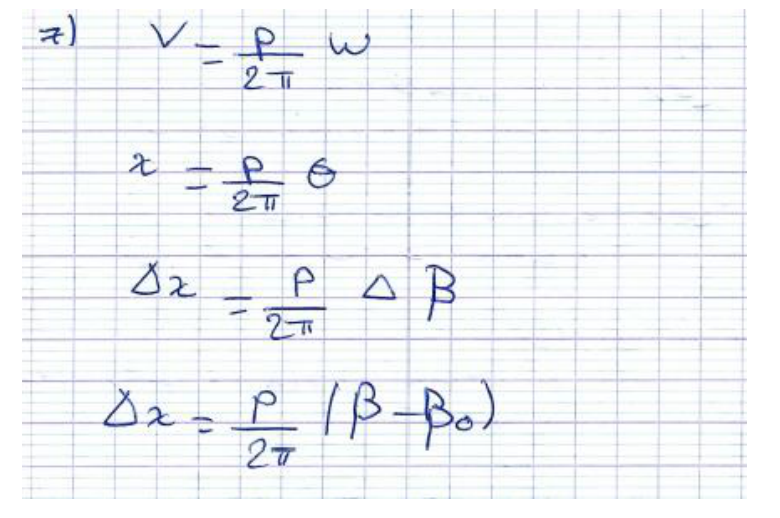 | 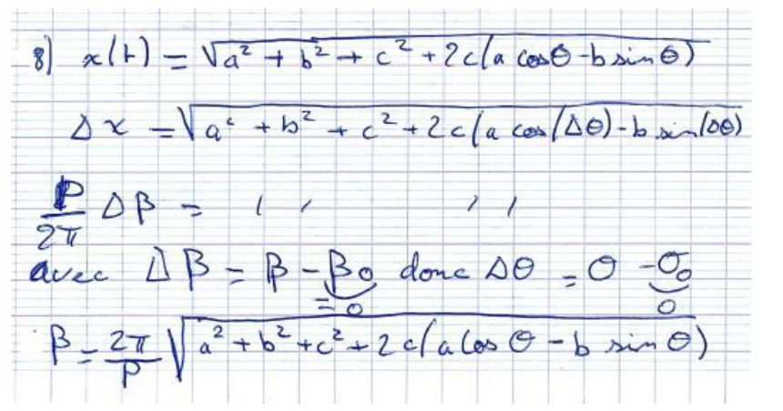 |

#### Linéarité
J'ai tracé θ(β) au tableur, avec une droite de tendance, pour savoir si la loi est linéaire :

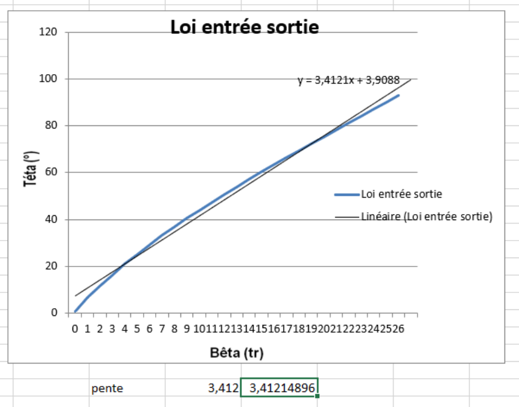

La loi est **presque linéaire**, avec une pente moyenne d'environ **3,41 °/tour**, mais elle s'infléchit en fin de course.

---

### 2. Modèle du moteur à courant continu sous Simscape (mai 2024)

#### Équations
- électrique : `U = R·i + L·di/dt + e`, avec `e = Ke·Ω` (force contre-électromotrice) ;
- électromécanique : `C = Kt·i` ;
- mécanique : `J·dΩ/dt = C − f·Ω − Cr`.

**Fiche du moteur :** 12 V, 8 700 tr/min à vide, 20 mA à vide, couple de démarrage 11,5 mN·m, courant de démarrage 1,26 A, R = 9,5 Ω, Kv = 953 tr/min/V, Kt = 9,62 mN·m/A, L = 0,82 mH.

#### Modèle
J'ai construit le modèle en blocs physiques :
- une source de tension continue, un ampèremètre et un voltmètre ;
- R et L en série ;
- un **convertisseur électromécanique** : la force contre-électromotrice côté électrique, le couple côté mécanique ;
- l'inertie et un capteur de vitesse de rotation ;
- les références électrique et mécanique, et le bloc de configuration du solveur.

| Blocs utilisés | Modèle complet |
|---|---|
| 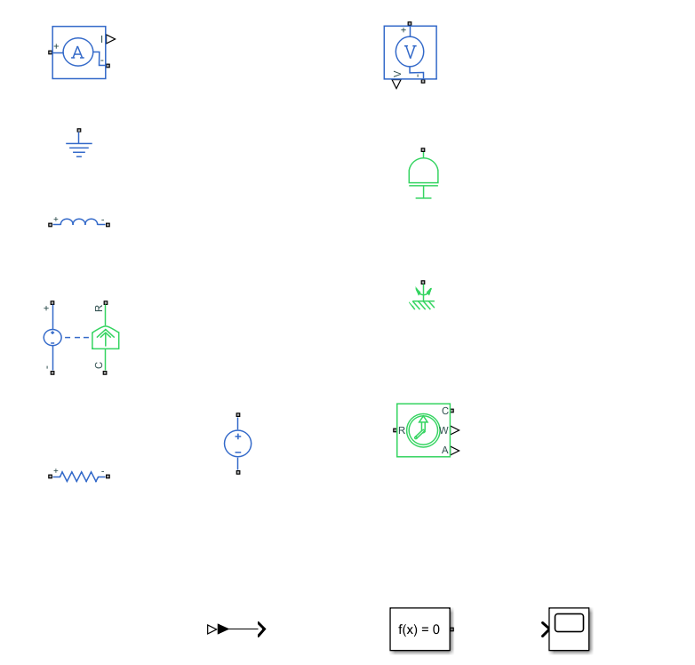 | 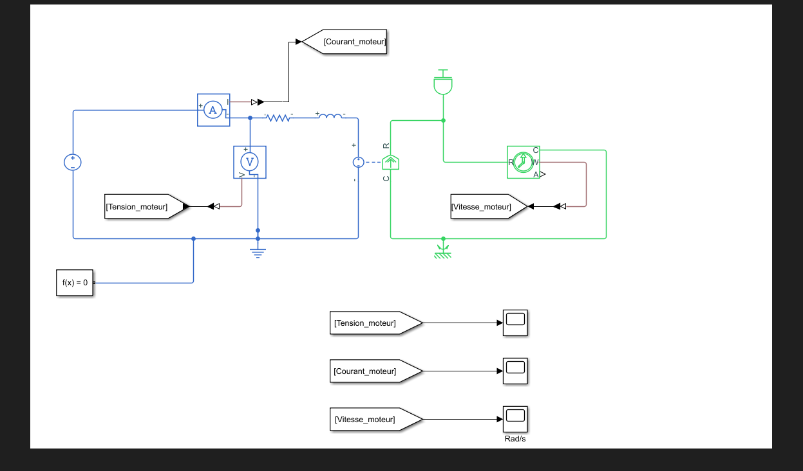 |

#### Simulation (10 s, sous 12 V)

| Tension (V) | Courant (A) | Vitesse (rad/s) |
|---|---|---|
| 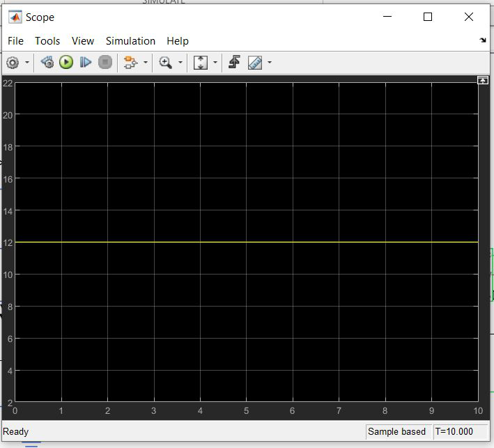 | 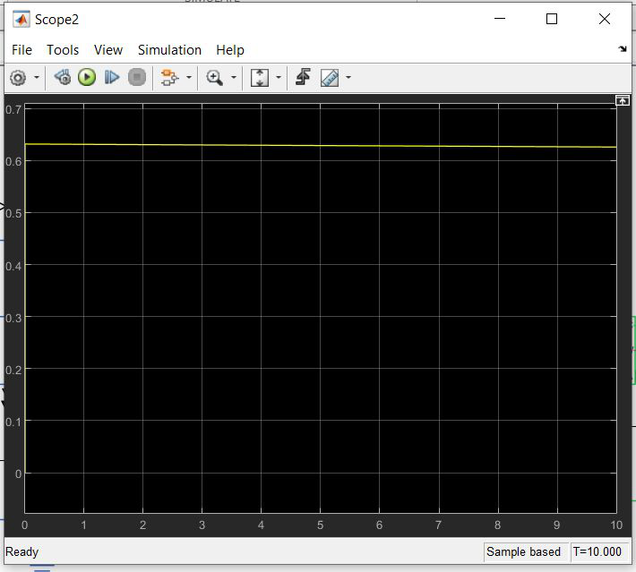 | 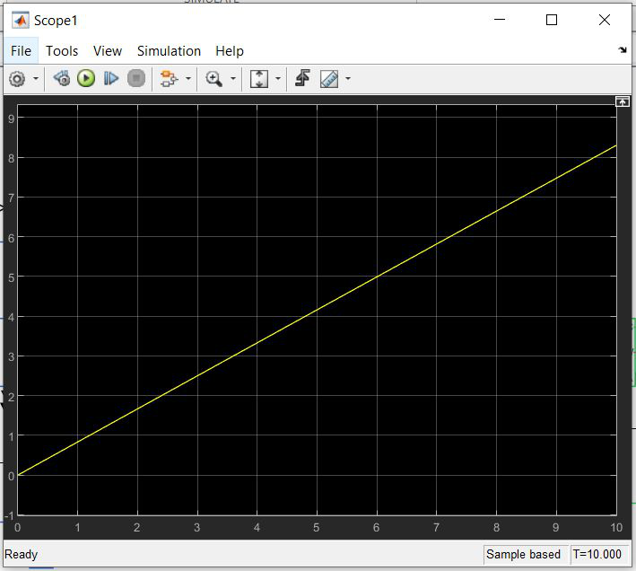 |

---

### Vérification en 2026
En reprenant ce travail, j'ai écrit deux scripts pour **confronter chaque modèle à un calcul indépendant**. C'est ce qu'on fait avant de s'appuyer sur un modèle pour régler un asservissement.

#### Cinématique : [`scripts/loi_entree_sortie.py`](scripts/loi_entree_sortie.py)
- **Précision du tableau de valeurs.** Le tableau a été établi avec une formule aux constantes arrondies (18000 pour a² + b² + c² = 17 954,25, et 170 pour x(0) = 170,51 mm). La loi exacte est décalée de 0,56 à 0,95° par rapport à lui. Sur un banc de TP, c'est négligeable, mais c'est l'ordre de grandeur à connaître si l'on veut un positionnement précis.
- **Droite de tendance.** La pente du tableur, 3,4121 °/tour, est confirmée. L'ordonnée à l'origine dépend du type de graphique : un graphique « Courbe » numérote les points de 1 à 27, alors qu'un « Nuage de points » utilise β = 0 à 26. Avec les vraies abscisses, on obtient θ = 3,4121·β + 7,32.
- **Non-linéarité chiffrée.** La pente locale passe de 5,6 °/tour au début de la course à 2,9 °/tour à la fin, et la courbe s'écarte jusqu'à 6,4° de la droite. Pour un asservissement d'angle, il faut soit en tenir compte dans le réglage, soit asservir β et convertir avec la loi exacte.
- **Écriture de la relation vis-écrou.** Pour un calcul direct, la relation la plus sûre est β = (x(θ₀) − x(θ))·2π/p (β en radians, hélice à droite). On garde ainsi explicitement la référence x(θ₀) et le signe de l'hélice.

#### Moteur : [`scripts/simulation_moteur.py`](scripts/simulation_moteur.py)
Le script re-simule le moteur avec les valeurs de la fiche (Runge-Kutta 4). L'inertie J ne figure pas sur la fiche : je l'ai **supposée** égale à 1·10⁻⁶ kg·m². Le frottement est calé sur le courant à vide.

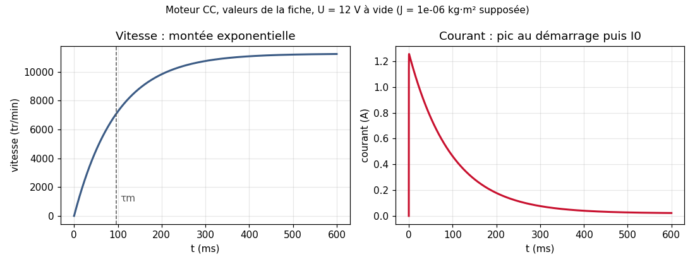

1. **La forme de la réponse.** Sous tension constante, on attend un pic de courant au démarrage (U/R = 1,26 A), puis une montée **exponentielle** de la vitesse, avec τm = J·R/(Ke·Kt) ≈ 97 ms ici. La simulation de 2024 montre une rampe droite et un courant presque constant (0,63 A), ce qui veut dire que les paramètres des blocs n'étaient pas ceux de la fiche. 12 V / 0,63 A ≈ 19 Ω, et la pente correspondrait à une inertie d'environ 7·10⁻³ kg·m². Ce sont vraisemblablement des valeurs par défaut des blocs. C'est le premier contrôle à faire sur une simulation : **la forme de la courbe est-elle physiquement plausible ?**
2. **La fiche et le moteur réel.** La fiche donne R = 9,5 Ω, alors que les mesures sur le banc donnaient entre 2 et 3 Ω. Pour un modèle fidèle, il faut identifier les paramètres sur le moteur monté : rotor bloqué pour R, essai à vide pour Ke, essai de lâcher pour J et f.
3. **La cohérence interne de la fiche.**
   - Ke = 60/(2π·953) = 0,0100 V·s/rad et Kt = 0,00962 N·m/A concordent à 4 % près, comme attendu en unités SI.
   - U/R redonne bien le courant de démarrage de la fiche.
   - En revanche, la vitesse à vide annoncée (8 700 tr/min) est en dessous de ce que donnent Kv et la tension (environ 11 400 tr/min) : il faudra la mesurer sur le banc.
4. **Ce qu'il reste à ajouter.** Le modèle représente le moteur seul. L'étape suivante consiste à ajouter le réducteur, la vis et l'inertie ramenée du bras, puis la charge. Avec la loi entrée-sortie de la partie 1, on obtient alors le modèle complet de l'axe, prêt pour le réglage d'un correcteur.

### Ce que ce travail m'a appris
- passer d'un mécanisme réel à un **schéma cinématique plan** et à une **loi entrée-sortie** par fermeture géométrique ;
- modéliser un **moteur à courant continu** en éléments physiques ;
- **vérifier un modèle** : la forme de la réponse, les ordres de grandeur, la cohérence de la fiche technique avec le matériel.

### Contenu du dépôt
```
docs/valeurs.md              longueurs, pas, fiche moteur, J supposée, équations
scripts/loi_entree_sortie.py loi exacte, tableau, droite des moindres carrés (2026)
scripts/simulation_moteur.py re-simulation du moteur, RK4, valeurs de la fiche (2026)
images/                      schéma cinématique (SVG), réponses manuscrites, tableur, Simscape, graphiques
```
Les scripts n'utilisent que Python 3 et, pour les graphiques, `matplotlib`.

---

## English

### Context
Engineering science work in **CPGE TSI** (preparatory classes, January and May 2024) on the **MaxPID**, a teaching bench for a position-controlled axis: a DC motor drives a screw, whose nut rotates an arm. I modelled it in two steps:
1. **kinematics:** planar kinematic diagram, geometric closure and the input-output law between screw rotation and arm angle;
2. **motor:** a physical model of the DC motor in **Simscape** (MATLAB).

In 2026 I revisited both models and checked them with Python scripts. All values and equations are in [`docs/valeurs.md`](docs/valeurs.md). The repository stops at modelling, with no controller; see my [PID controller](https://github.com/Valentin-Auger-Laboratoire/regulateur-pid) for the closed loop.

### 1. Arm kinematics
Planar diagram (above), OA = 69.5 mm, OB = 82 mm, AC = 80 mm, screw pitch 4 mm/turn.
- **Geometric closure** OA + AC + CB + BO = 0 gives x(θ) = √(a² + b² + c² + 2c(a·cos θ − b·sin θ)).
- **Screw and nut** (β = 0 at θ = 0): β(θ) = (x(0) − x(θ))/p, with x(0) = 170.51 mm.
- **Linearity:** plotted in a spreadsheet, the law is nearly linear (about 3.41 °/turn) but bends towards the end of travel.

### 2. DC motor model in Simscape
`U = R·i + L·di/dt + Ke·Ω`, `C = Kt·i`, `J·dΩ/dt = C − f·Ω − Cr`, built with physical blocks (source, R, L, electromechanical converter, inertia, sensors), using the datasheet values (12 V, R = 9.5 Ω, L = 0.82 mH, Kv = 953 rpm/V, Kt = 9.62 mN·m/A).

### 2026 verification
I wrote two scripts to **check each model against an independent calculation**.
- **Kinematics:**
  - The rounded constants used for the value table shift it by 0.56 to 0.95°.
  - The spreadsheet slope (3.4121 °/turn) is confirmed. The intercept depends on the chart type ("line" charts number the points 1 to 27): with the real abscissas, θ = 3.4121·β + 7.32.
  - The local slope goes from 5.6 to 2.9 °/turn, up to 6.4° away from a straight line, which matters when tuning an angle controller.
- **Motor:** a re-simulation with the datasheet values and an **assumed** J = 1·10⁻⁶ kg·m² gives the expected 1.26 A current peak and an exponential speed rise with τm ≈ 97 ms. The 2024 run showed a straight ramp, meaning the block parameters were not the datasheet ones (probably defaults); that is the first check on any simulation. In addition:
  - the datasheet resistance (9.5 Ω) differs from the bench measurement (2 to 3 Ω), so parameters should be identified on the real motor;
  - the stated no-load speed is below what Kv predicts;
  - the next step is to add the gearbox, screw and arm inertia to get the full axis model.

### What I learned
Going from a real mechanism to a planar kinematic diagram and an input-output law, modelling a DC motor with physical blocks, and **verifying a model**: response shape, orders of magnitude, and whether the datasheet matches the hardware.
